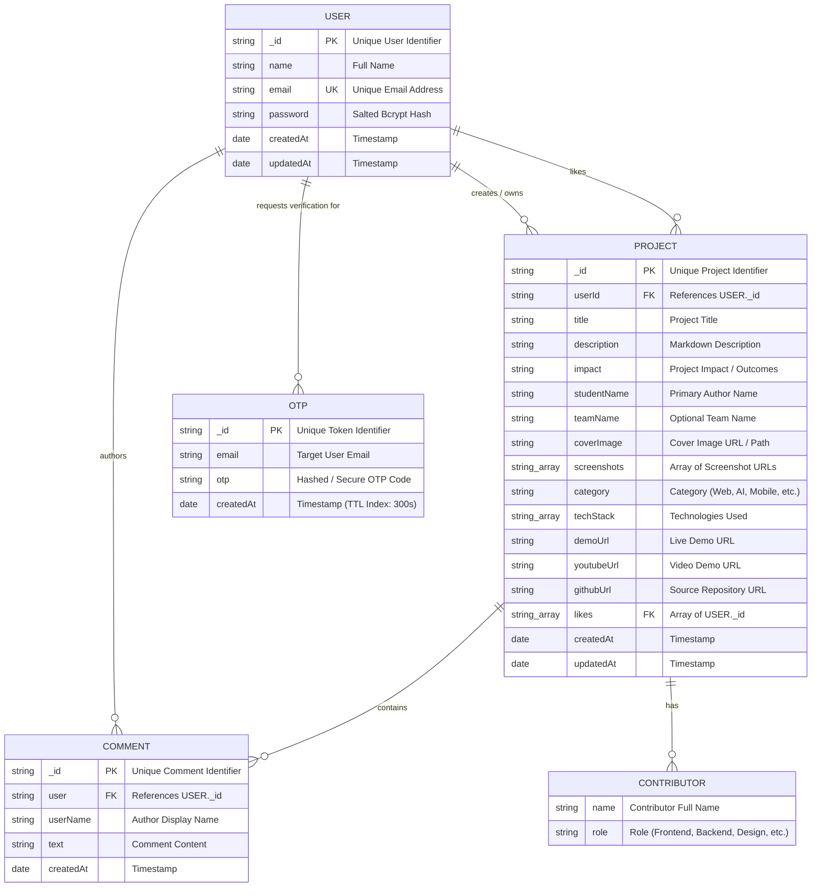
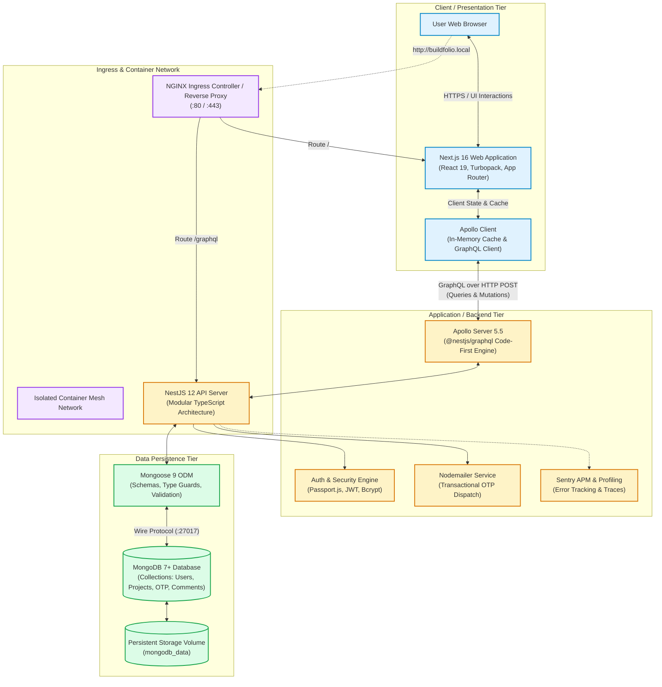
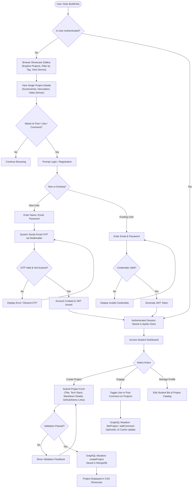

# BuildFolio — Project Diagrams (Mermaid)

This file contains the Mermaid code for the **Entity-Relationship (ER) Diagram**, **System Architecture Diagram**, and **Flowchart / User Journey Diagram**. You can paste these code blocks into Markdown previewers, Notion, GitHub, or [mermaid.live](https://mermaid.live).

---

## 1. Entity-Relationship (ER) Diagram

---

## 2. System Architecture Diagram

---

## 3. Flowchart: User Journey & Project Lifecycle

